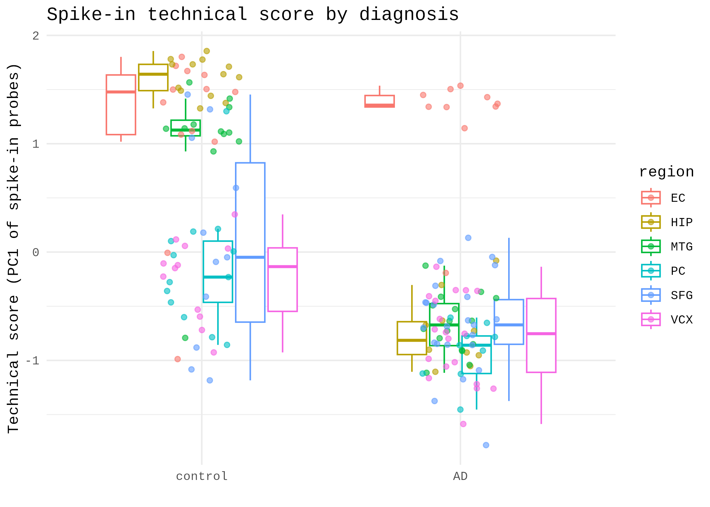
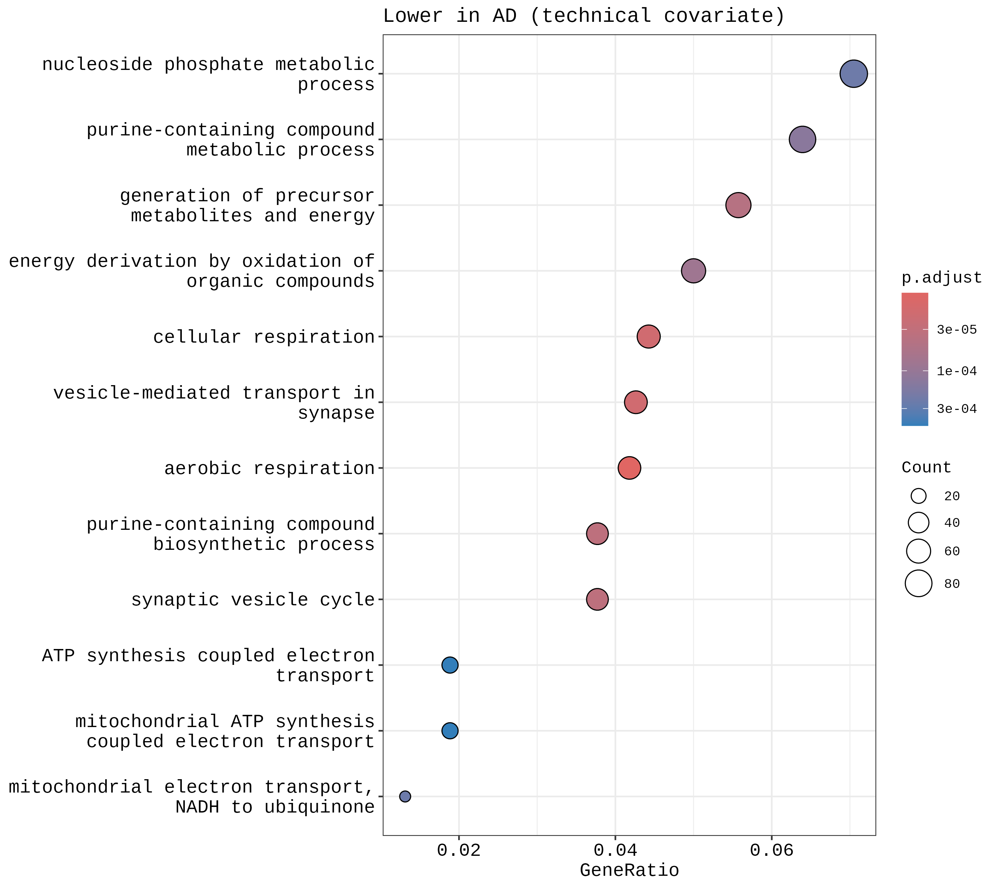

# Alzheimer's Disease Brain Transcriptomics, Pathway Enrichment and Drug-Gene Mining

**Rebecca Manzini** · Independent project · September to October 2026

## Abstract

Alzheimer's disease (AD) is a leading cause of dementia with limited disease-modifying treatment. This project analyses a public microarray dataset of laser-capture microdissected cortical neurons from post-mortem AD and control brains (GEO GSE5281; 87 AD and 74 control samples from six regions) to test whether a transparent, reproducible pipeline recovers established AD biology, how robust that signal is, and whether it identifies genes with pharmacological relevance. Quality control revealed two technical issues. Affymetrix control probes appeared among the top results and were removed, and diagnosis was completely confounded with processing batch, with all controls and all AD samples falling in separate GEO accession ranges and a spike-in technical score that differs between groups. After removing 62 control probes and 8 outlier arrays and adjusting for brain region, limma identified 2,316 probes that differ by at least 1.5-fold (FDR < 0.05), of which 1,367 were higher and 949 lower in AD. Genes lower in AD were enriched for aerobic respiration, ATP synthesis-coupled electron transport and synaptic vesicle transport, and this enrichment persisted when a spike-in technical covariate was added to the model. Genes higher in AD gave inconsistent enrichment across models and are not interpreted. Querying the top 50 genes against the Drug Gene Interaction Database (DGIdb) returned 457 interactions across 20 genes, of which 30 across 9 genes were direction-compatible, meaning an inhibitor of a gene that is higher in AD. Comparison with an independent blood cohort (GSE63060, 249 arrays) showed modest cross-tissue concordance (Spearman rho = 0.16). The results are exploratory and are presented as hypotheses, not validated targets.

## Research Question

Can differential gene expression analysis of Alzheimer's disease brain tissue identify dysregulated genes with existing pharmacological relevance, and how robust is that signal to quality control choices, technical confounding and comparison across tissues?

## Data

- **GSE5281.** Affymetrix Human Genome U133 Plus 2.0 (GPL570). Laser-capture microdissected cortical pyramidal neurons (non-tangle-bearing in AD cases), 161 samples (87 AD, 74 control) from six regions (entorhinal cortex, hippocampus, middle temporal gyrus, posterior cingulate, superior frontal gyrus, primary visual cortex). Region labels were derived from the sample annotation text.
- **Batch structure.** All 74 controls have accession numbers in the GSM11xxxx range and all 87 AD samples in the GSM23xxxx range, which indicates separately deposited sets.
- **GSE63060.** AddNeuroMed peripheral blood, Illumina HumanHT-12 (GPL6947), AD vs control only (145 AD, 104 control).
- **DGIdb.** Queried through its GraphQL API on 2026-10-25.

## Methods

1. **Preprocessing.** Intensities were on a linear scale, so values were log2(x + 1) transformed.
2. **Quality control.** Sample distributions and PCA were inspected. 62 Affymetrix control probes were removed because they are not human genes. Eight arrays were flagged using a robust z-score above 4 on array median or upper quartile. All eight were controls (GSM119619, GSM119649, GSM119661, GSM119671, GSM119672, GSM119673, GSM119674, GSM119676). This rule was chosen after inspecting the QC plots, so results were checked in sensitivity analyses.
3. **Technical score.** The first principal component of 24 bacterial spike-in probes was used as a proxy for technical variation. It differs by diagnosis (control mean 0.60, AD mean -0.51; R2 with group 0.31, with region 0.38).
4. **Normalisation and filtering.** Arrays were quantile normalised and the lowest 50% of probes by mean intensity were removed (27,306 probes retained).
5. **Differential expression.** limma with brain region as a covariate, testing against a minimum 1.5-fold change (`treat`), Benjamini-Hochberg FDR < 0.05. The sensitivity analysis added the technical score as a covariate.
6. **Annotation and enrichment.** Probes were mapped to gene symbols (first symbol for probes mapping to several genes). GO Biological Process enrichment used clusterProfiler with the genes on the array as background, run separately for genes higher and lower in AD.
7. **Drug-gene mining.** The top 50 genes by significance were queried against DGIdb. An interaction was labelled direction-compatible if the drug inhibits, antagonises or negatively modulates a gene that is higher in AD, or activates a gene that is lower in AD.
8. **Cross-tissue comparison.** Blood and brain results were collapsed to gene level (most significant probe per gene) and compared across all 11,765 shared genes using moderated t statistics.

## Results

### Technical confounding

Diagnosis is completely confounded with processing batch in this dataset, and a spike-in technical score differs between groups. No model can fully separate disease from batch, so the primary and technical-covariate analyses are reported together.



### Differential expression

| Analysis | Significant probes |
|---|---|
| Original analysis (group only, all probes and arrays, abs log2FC > 1) | 2,972 |
| **Primary** (region-adjusted, control probes and 8 flagged arrays removed, quantile normalised, tested against a 1.5-fold minimum) | **2,316** |
| Primary, ordinary test, no fold-change threshold | 15,574 |
| Primary, ordinary test, abs log2FC > log2(1.5) | 8,501 |
| Sensitivity, plus technical covariate, tested against a 1.5-fold minimum | 17 |
| Sensitivity, plus technical covariate, ordinary test, abs log2FC > log2(1.5) | 4,056 |
| Sensitivity, plus technical covariate, ordinary test, no threshold | 5,835 |

The primary model identified 2,316 probes (1,367 higher, 949 lower in AD). Adding the technical covariate shrinks effect sizes to about two-thirds (slope 0.67) while preserving probe ranking (Spearman rho of moderated t = 0.86). Because the technical score is itself related to diagnosis, adjusting for it probably removes some real signal along with artefact, so the two analyses bracket the plausible result.


### Pathway enrichment

Genes lower in AD were enriched for aerobic respiration (adjusted p = 1.3e-8), cellular respiration (1.4e-7), vesicle-mediated transport in synapse (5.5e-7) and ATP synthesis-coupled electron transport (1.8e-6). With the technical covariate the same themes persisted (aerobic respiration 1.0e-5, vesicle-mediated transport in synapse 1.8e-5, synaptic vesicle cycle 3.3e-5). These match the mitochondrial and synaptic dysfunction widely reported in AD brain.

Genes higher in AD were not stable across models. The primary model gave weak differentiation and morphogenesis terms (adjusted p about 0.008), while the covariate-adjusted model gave cytokine-response and cell-migration terms, so these are not interpreted here.




### Drug-gene mining

DGIdb returned 457 interactions across 20 of the top 50 genes. Thirty interactions across 9 genes were direction-compatible (ACACB, CDK13, CFLAR, ITPKB, MAP4K4, PGF, SLC5A3, THRA and WNK1). Genes lower in AD that have drug interactions are not treated as hypotheses, because an inhibitor of an already downregulated gene is not a sensible lead. Some compatible drugs are large biologics (for example aflibercept and conbercept against PGF) that are unlikely to cross the blood-brain barrier, so central nervous system druggability would need separate assessment. Full tables are in `results/`.

### Cross-tissue comparison with blood

Across 11,765 shared genes, brain and blood moderated t statistics showed a small positive correlation (Spearman rho = 0.158, p = 1.6e-66). Of 1,411 primary-significant genes, 794 (56.3%) moved in the same direction in blood (binomial p = 2.7e-6). With the technical-covariate brain effects, rho was 0.094 and 800 genes (56.7%) agreed in direction (binomial p = 5.4e-7). Blood is a different tissue, so this is evidence of partial agreement, not replication. The earlier threshold-based overlap test in the original analysis (p = 0.194) was underpowered because only 2 significant blood genes fell on the shared gene background.

## Limitations

- **Neurons only.** Samples are laser-capture microdissected neurons, so the results cannot speak to glial changes, and signal from neighbouring cells cannot be fully excluded. The small RNA input per sample makes technical variation plausible.
- **Batch confounding.** Diagnosis is completely confounded with processing batch. A spike-in covariate is an imperfect proxy, and the persistence of the respiration and synaptic signal and the agreement with blood support robustness but do not remove the confound.
- **Single brain cohort.** There is no independent brain replication.
- **Post hoc outlier rule.** It was chosen after inspecting the data and checked in sensitivity analyses.
- **Annotation.** A minority of gene symbols did not map in the enrichment analysis.
- **Drug-gene mining.** DGIdb is not exhaustive and an interaction is not evidence of efficacy. Expression changes may be consequences of disease, not causes.

## Future work

Replicate in independent brain cohorts where diagnosis is spread across processing batches, fit region-specific models, and repeat in RNA-seq or single-nucleus data.

## Reproducing

Run in R 4.6.1 and Bioconductor 3.23 (Google Colab). The notebook `notebooks/ad_transcriptomics_analysis.ipynb` downloads GSE5281 and GSE63060 automatically and runs the full pipeline, including the DGIdb query, from top to bottom. DGIdb results depend on the database version on the query date.

## Repository structure

```
notebooks/   Full analysis notebook
scripts/     drug_target_mining.py (standalone DGIdb step)
results/     Tables, enrichment results, sensitivity summary, session info
figures/     QC, PCA, volcano, heatmap and GO plots
legacy_original_analysis/   Original scripts (original analysis)
```

## References

- Gene Expression Omnibus, accession GSE5281. National Center for Biotechnology Information.
- Gene Expression Omnibus, accession GSE63060 (AddNeuroMed Cohort). National Center for Biotechnology Information.
- Liang, W.S. et al. (2008) Alzheimer's disease is associated with reduced expression of energy metabolism genes in posterior cingulate neurons. *PNAS*.
- Ritchie, M.E. et al. (2015) limma powers differential expression analyses for RNA-sequencing and microarray studies. *Nucleic Acids Research*.
- McCarthy, D.J. and Smyth, G.K. (2009) Testing significance relative to a fold-change threshold is a TREAT. *Bioinformatics*.
- Bolstad, B.M. et al. (2003) A comparison of normalization methods for high density oligonucleotide array data based on variance and bias. *Bioinformatics*.
- Davis, S. and Meltzer, P.S. (2007) GEOquery, a bridge between the Gene Expression Omnibus (GEO) and BioConductor. *Bioinformatics*.
- Yu, G. et al. (2012) clusterProfiler, an R package for comparing biological themes among gene clusters. *OMICS*.
- Wu, T. et al. (2021) clusterProfiler 4.0, a universal enrichment tool for interpreting omics data. *The Innovation* 2(3), 100141.
- Freshour, S.L. et al. (2021) Integration of the Drug-Gene Interaction Database (DGIdb 4.0) with open crowdsource efforts. *Nucleic Acids Research*.
