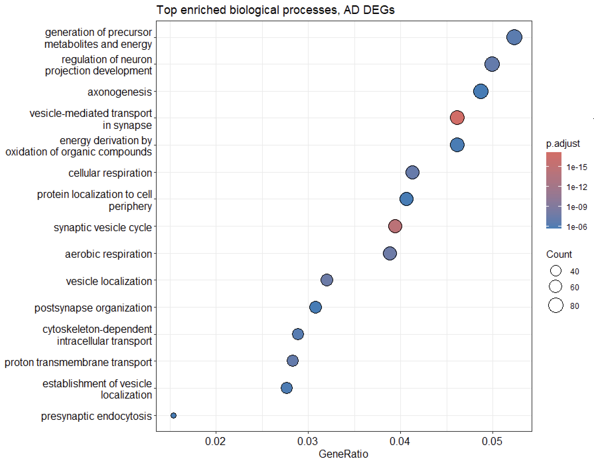

# Identifying Druggable Targets in Alzheimer's Disease Through Independent Computational Transcriptomic Analysis

**Rebecca Manzini** · Independent project · September 2026

## Abstract

Alzheimer’s disease (AD) remains a leading cause of dementia with limited disease-modifying treatment options. This project applies an independent computational pipeline to public transcriptomic data to test whether differential expression analysis of AD brain tissue can recover established AD biology and identify genes with existing pharmacological relevance. Using microarray data from 161 post-mortem brain samples (GEO GSE5281), differential expression analysis identified 2,972 significantly dysregulated probes between AD and control tissue. Gene Ontology enrichment pointed to synaptic vesicle transport and mitochondrial and metabolic processes, both established in AD pathology. Querying the top 50 significant genes against the Drug Gene Interaction Database (DGIdb) returned 449 gene-drug interactions across 19 genes. An attempted validation in an independent blood dataset (GSE63060) was inconclusive because too few genes were significant for a powered test. The results are exploratory and are presented as a reproducible pipeline and a set of hypotheses, not as validated targets.

## Research Question

Can differential gene expression analysis of AD brain tissue identify dysregulated genes with existing pharmacological relevance, connecting a purely data-driven transcriptomic signature to potential therapeutic targets?

## Dataset

| | |
|---|---|
| Source | Gene Expression Omnibus (GEO), accession **GSE5281** |
| Type | Affymetrix microarray, human post-mortem brain tissue |
| Platform | GPL570 (Affymetrix Human Genome U133 Plus 2.0 Array) |
| Groups | Alzheimer's disease (AD) vs. healthy control |
| Sample size | 161 total (87 AD, 74 control) |
| Brain regions | Entorhinal cortex, hippocampus, middle temporal gyrus, posterior cingulate, superior frontal gyrus, primary visual cortex |

## Methods

1. **Preprocessing.** Raw expression values log2-transformed (log2(x+1))
2. **Differential expression.** limma (R/Bioconductor), moderated t-statistics via eBayes
3. **Multiple testing correction.** Benjamini-Hochberg (BH)
4. **Significance thresholds.** Adjusted p < 0.05, |log2 fold change| > 1
5. **Gene annotation.** Probe-to-symbol mapping via GPL570 platform annotation
6. **Functional enrichment.** GO Biological Process via clusterProfiler
7. **Drug-target mining.** Top 50 significant genes queried against DGIdb (GraphQL API)

**Tools:** R (limma, GEOquery, clusterProfiler, org.Hs.eg.db, ggplot2, pheatmap), Python (pandas, requests)

## Results

### Differential expression

2,972 probes met significance thresholds. The volcano plot below shows greater spread among downregulated genes than upregulated genes, consistent with the AD literature, where downregulation typically predominates, reflecting broad neuronal loss and reduced synaptic/metabolic activity.


*Figure 1. Volcano plot of differential gene expression, AD vs. control (GSE5281). Red points met significance thresholds (adjusted p < 0.05, |log2FC| > 1); n = 2,972 significant probes.*

Unsupervised hierarchical clustering of the top 30 differentially expressed genes largely recovered the known AD/control grouping without being given group labels, indicating a strong underlying transcriptional signal.


*Figure 2. Heatmap of top 30 differentially expressed genes by adjusted p-value, row-scaled expression, with hierarchical clustering of genes and samples.*

### Functional enrichment

GO Biological Process enrichment identified vesicle-mediated transport in synapse, synaptic vesicle cycle, aerobic/cellular respiration, and regulation of neuron projection development among the top enriched terms, aligning with two of the most established mechanisms in AD pathology, namely synaptic dysfunction and mitochondrial/metabolic impairment.



*Figure 3. Dot plot of top enriched GO Biological Process terms. Dot size = gene count; colour = BH-adjusted p-value; x-axis = gene ratio.*

### Drug-target mining

Querying the top 50 significant genes against DGIdb returned **449 gene-drug interactions**, with 19/50 genes having at least one known interaction. SNAP25, central to the synaptic vesicle cycle, was among the genes with known interactions. Its DGIdb partners are botulinum toxin compounds, which cleave SNAP25, so this serves as a check that the database mapping and the enrichment result point to the same biology, not as a therapeutic suggestion. Two separate analytical steps converging on the same biology.

*Note: interaction scores reflect DGIdb's internal weighting, not clinical efficacy. Approval status of individual compounds should be verified separately before any therapeutic interpretation.*

## Independent Validation (GSE63060)

To address the single-dataset limitation directly, the differential expression pipeline was re-run on an independent, entirely separate dataset: [GSE63060](https://www.ncbi.nlm.nih.gov/geo/query/acc.cgi?acc=GSE63060), 249 peripheral blood samples (145 AD, 104 control) from the AddNeuroMed Cohort, profiled on a different platform (Illumina HumanHT-12 V3.0, GPL6947) from a different patient population entirely.

At the same significance thresholds (adjusted p < 0.05, |log2FC| > 1), 8 genes were significant in blood, of which 2 fell within the gene set shared across both microarray platforms. Of these, **NDUFA1** also appeared among the significant genes in the original brain-tissue analysis (GSE5281).

To test whether this overlap exceeds chance, a hypergeometric test was run against the shared background of 17,201 genes measured on both platforms (1,758 significant in brain tissue, 2 significant-and-shared in blood, 1 gene in common), giving **p = 0.194, not statistically significant**. With only 2 genes from the blood dataset landing on the shared background, the test is underpowered, one overlapping gene out of two is too small a sample to distinguish "more overlap than chance" from noise in either direction. This is reported plainly rather than overstated. The honest conclusion is that this validation is inconclusive on statistical grounds, not that it confirms replication.

What the overlap does offer is a biologically motivated observation rather than a statistically validated one. NDUFA1 is a subunit of mitochondrial Complex I (NADH:ubiquinone oxidoreductase), sitting within the aerobic/cellular respiration pathways identified independently through GO enrichment of the brain-tissue data (see Functional Enrichment above). This is consistent with, but does not statistically confirm, the pathway-level finding from a separate analytical step. A dataset with more significant genes surviving into the shared background (e.g. a larger blood cohort, or a less stringent significance threshold applied specifically for the validation step) would be needed for a properly powered test.

## Discussion

This analysis demonstrates that an unsupervised, purely computational approach applied to public transcriptomic data can recover established AD biology and identify existing pharmacological entry points without disease-specific assumptions built into the pipeline. The convergence between differential expression, pathway enrichment, and drug-target mining around synaptic mechanisms, most notably the SNAP25/botulinum toxin result, is consistent with the pipeline recovering known biology. Cross-dataset comparison against a second, tissue- and platform-distinct dataset (GSE63060) identified one gene (NDUFA1) common to both significant gene lists. A hypergeometric test found this overlap not statistically distinguishable from chance (p = 0.194), reflecting the limited statistical power available from only 8 significant blood genes rather than evidence against the finding. NDUFA1's role in mitochondrial Complex I is biologically consistent with the respiration-related pathways identified via GO enrichment, offering a plausible but not statistically confirmed link between the two datasets.

## Limitations and Future Directions

- **Underpowered cross-tissue validation.** Only 8 genes were significant in the blood dataset (2 on the shared background), too few for a well-powered overlap test. The hypergeometric result (p = 0.194) is inconclusive rather than confirmatory, and a larger blood cohort or relaxed validation-specific threshold would be needed to test this properly
- **Interaction scores are not clinical efficacy.** DGIdb scores reflect database weighting, not approval status or therapeutic validity
- **Correlative, not causal.** Functional validation (e.g. in vitro knockdown/rescue) would be needed to establish causal gene relevance
- **Brain region not modelled as a covariate.** A region-stratified re-analysis of GSE5281 could reveal signal currently averaged out

## Repository Structure

```
├── README.md
├── scripts/
│   ├── differential_expression_analysis.R   # primary pipeline (GSE5281)
│   ├── validation_analysis.R                # independent validation (GSE63060)
│   └── drug_target_mining.py                # DGIdb query script
└── figures/
    ├── volcano_plot_AD_vs_control.png
    ├── heatmap_top30_genes.png
    └── go_enrichment_dotplot.png
```

## References

- Gene Expression Omnibus, accession GSE5281. National Center for Biotechnology Information.
- Gene Expression Omnibus, accession GSE63060 (AddNeuroMed Cohort). National Center for Biotechnology Information.
- Ritchie, M.E. et al. (2015) limma powers differential expression analyses for RNA-sequencing and microarray studies. *Nucleic Acids Research*.
- Yu, G. et al. (2012) clusterProfiler: an R package for comparing biological themes among gene clusters. *OMICS*.
- Freshour, S.L. et al. (2021) Integration of the Drug-Gene Interaction Database (DGIdb 4.0) with open crowdsource efforts. *Nucleic Acids Research*.
