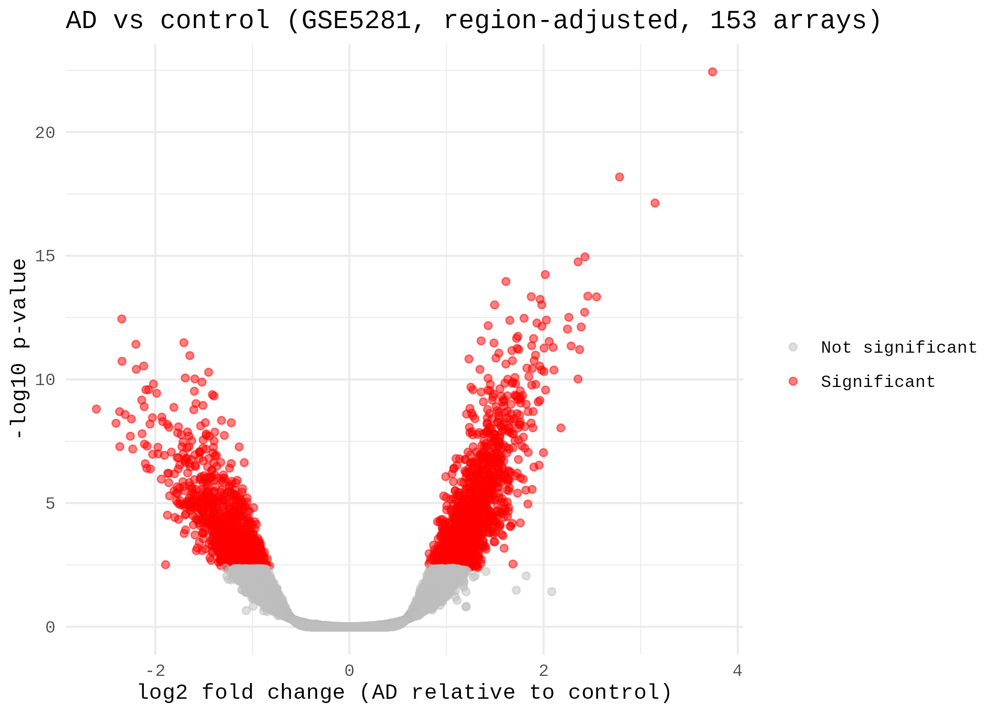
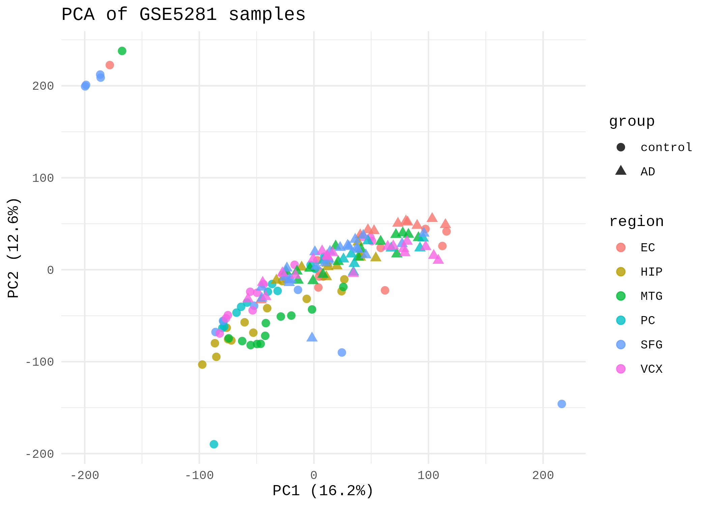
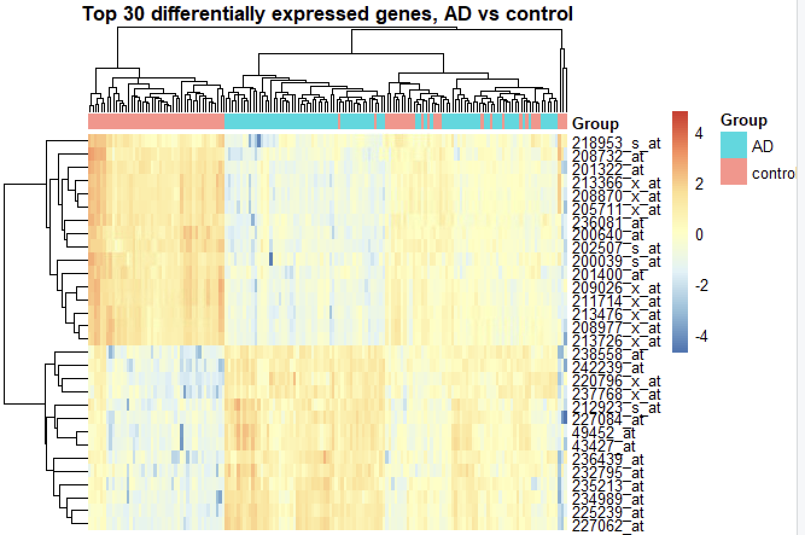
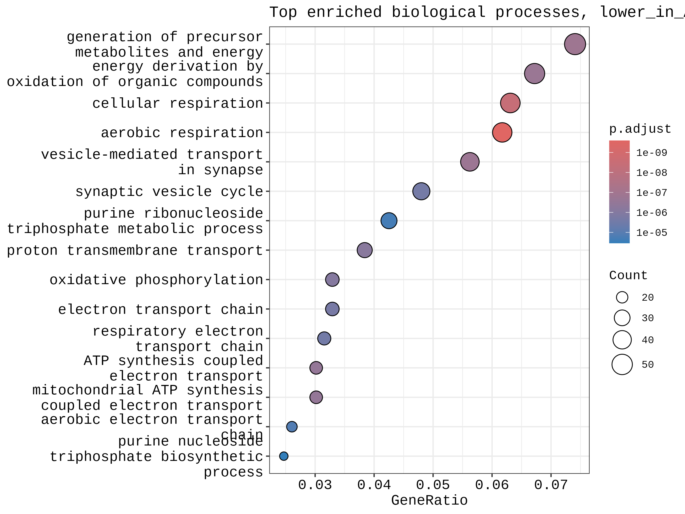
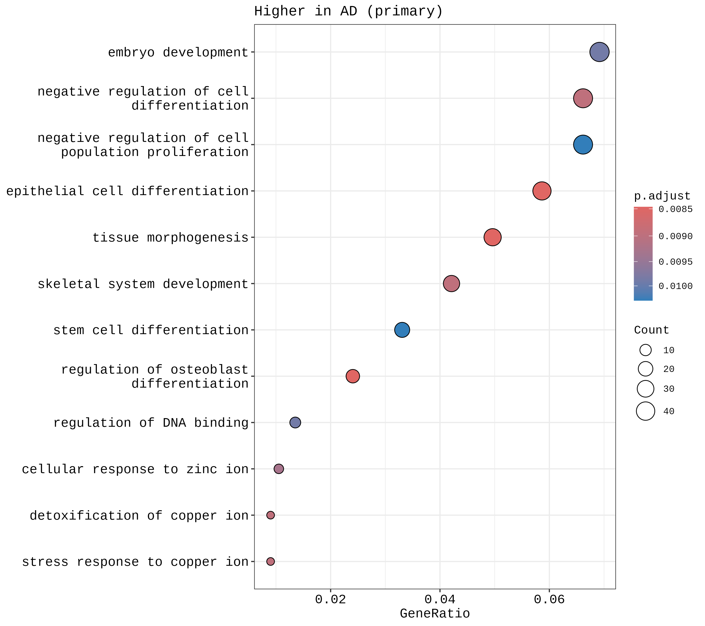

# Alzheimer's Disease Brain Transcriptomics, Pathway Enrichment and Drug-Gene Mining

**Rebecca Manzini** · Independent project · September to October 2026

## Abstract

Alzheimer's disease is a leading cause of dementia with limited disease-modifying treatment. This project analyses public post-mortem brain transcriptomic data (GEO GSE5281; 87 AD and 74 control samples from six brain regions) to test whether a transparent, reproducible pipeline recovers established AD biology and identifies genes with existing pharmacological relevance. After quality control, removal of 8 outlier arrays (tested in sensitivity analyses) and adjustment for brain region, limma identified 2,353 probes that differ between AD and control by at least 1.5-fold (FDR < 0.05), of which 1,385 were higher and 968 lower in AD. Genes lower in AD were strongly enriched for aerobic respiration, ATP synthesis-coupled electron transport and synaptic vesicle transport. Querying the top 50 genes against the Drug Gene Interaction Database (DGIdb) returned 457 interactions across 20 genes, of which 30 across 9 genes were direction-compatible, meaning an inhibitor of a gene that is higher in AD. Comparison with an independent blood cohort (GSE63060) showed modest cross-tissue concordance (Spearman rho = 0.16). The results are exploratory and are presented as hypotheses, not validated targets.

## Research Question

Can differential gene expression analysis of Alzheimer's disease brain tissue identify dysregulated genes with existing pharmacological relevance, and how robust is that signal to quality control choices and across tissues?

## Data

- **GSE5281.** Affymetrix Human Genome U133 Plus 2.0 (GPL570), 161 post-mortem brain samples (87 AD, 74 control) from six regions (entorhinal cortex, hippocampus, middle temporal gyrus, posterior cingulate, superior frontal gyrus, primary visual cortex). Region labels were derived from the sample annotation text.
- **GSE63060.** AddNeuroMed peripheral blood, Illumina HumanHT-12 (GPL6947), AD vs control only (145 AD, 104 control).
- **DGIdb.** Queried through its GraphQL API on 2026-10-25.

## Methods

1. **Preprocessing.** Intensities were on a linear scale, so values were log2(x + 1) transformed. Array quality was assessed with sample distributions and PCA.
2. **Outlier arrays.** Eight arrays were flagged using a robust z-score above 4 on array median or upper quartile. All eight were controls (GSM119619, GSM119649, GSM119661, GSM119671, GSM119672, GSM119673, GSM119674, GSM119676). This rule was chosen after inspecting the QC plots, so it was tested in sensitivity analyses (below).
3. **Normalisation and filtering.** Arrays were quantile normalised and the lowest 50% of probes by mean intensity were removed (27,337 of 54,675 retained).
4. **Differential expression.** limma with brain region as a covariate, testing against a minimum 1.5-fold change (`treat`), Benjamini-Hochberg FDR < 0.05.
5. **Annotation and enrichment.** Probes were mapped to gene symbols (first symbol for probes mapping to several genes). GO Biological Process enrichment used clusterProfiler with the genes on the array as background, run separately for genes higher and lower in AD.
6. **Drug-gene mining.** The top 50 genes by significance were queried against DGIdb. An interaction was labelled direction-compatible if the drug inhibits, antagonises or negatively modulates a gene that is higher in AD, or activates a gene that is lower in AD.
7. **Cross-tissue comparison.** Blood and brain results were collapsed to gene level (most significant probe per gene) and compared across all 11,762 shared genes. Brain statistics came from the moderated t of Model D, because `treat` sets small effects to zero and creates ties.

## Results

### Differential expression

The primary model identified **2,353 probes** (1,385 higher, 968 lower in AD). Region is partly confounded with disease in this dataset (for example 23 AD and 11 control superior frontal samples), which is why it is included as a covariate.

| Model | Significant probes |
|---|---|
| A. Original analysis (group only, all probes, abs log2FC > 1) | 2,972 |
| B. Region-adjusted, all arrays, abs log2FC > log2(1.5) | 8,953 |
| C. B with 8 flagged arrays removed | 9,157 |
| D. C with quantile normalisation | 8,544 |
| **E. D tested against a 1.5-fold minimum (primary)** | **2,353** |
| F. E with all arrays and a flagged-array covariate | 2,141 |

Models E and F share 2,120 probes and their log fold changes correlate at essentially 1, so the main result does not depend on excluding the flagged arrays. 1,924 of the original 2,972 probes remain significant in the primary model.







### Pathway enrichment

Genes lower in AD were enriched for aerobic respiration (adjusted p = 2.6e-10), cellular respiration, generation of precursor metabolites and energy, vesicle-mediated transport in synapse (adjusted p = 1.7e-7) and ATP synthesis-coupled electron transport. These match the mitochondrial and synaptic dysfunction widely reported in AD brain. Genes higher in AD showed weaker enrichment for differentiation, morphogenesis and metal-ion response terms (adjusted p about 0.007 to 0.009).





### Drug-gene mining

DGIdb returned 457 interactions across 20 of the top 50 genes. Thirty interactions across 9 genes were direction-compatible, including inhibitors of PGF, ITPKB, SLC5A3, CDK13, WNK1, ACACB, THRA and MAP4K4. Genes lower in AD, such as SNAP25 and CDC37, appear in the database, but an inhibitor of a downregulated gene is not a sensible hypothesis, so these serve as sanity checks. Some compatible drugs are large biologics (for example aflibercept and conbercept against PGF) that are unlikely to cross the blood-brain barrier, so central nervous system druggability would need separate assessment. Full tables are in `results/`.

### Cross-tissue comparison with blood

Across 11,762 shared genes, brain and blood moderated t statistics showed a small positive correlation (Spearman rho = 0.16, p = 1.3e-67). Of 1,415 brain-significant genes measured in both datasets, 792 (56%) moved in the same direction in blood (binomial p = 7.8e-6), and 367 of these were also nominally significant in blood (p < 0.05). The concordant genes with the strongest blood signal were mostly lower in both tissues and included mitochondrial and oxidative stress genes (ATP6V1E1, PSMA3, TXN, PRDX1, SOD1, COX7B). Blood is a different tissue, so this is evidence of partial agreement, not replication. The earlier threshold-based overlap test (p = 0.194) was underpowered because only 2 significant blood genes fell on the shared gene background.

## Limitations

- Bulk post-mortem tissue, so some differences may reflect changes in cell composition or tissue quality, not only disease pathways.
- A single brain cohort on a microarray platform, with no independent brain replication.
- The outlier rule was chosen after inspecting the data. Sensitivity analyses show the result is stable, but this should be stated.
- 6 to 9% of gene symbols did not map in enrichment analysis.
- DGIdb is not exhaustive and an interaction is not evidence of efficacy. Expression changes may be consequences of disease, not causes.

## Future work

Replicate in an independent brain cohort, fit region-specific models, estimate cell-type proportions, and repeat in RNA-seq data.

## Reproducing

Run in R 4.6.1 and Bioconductor 3.23 (Google Colab). Download `GSE5281_series_matrix.txt.gz` from GEO into a `data/` folder, then run `notebooks/ad_transcriptomics_analysis.ipynb` from top to bottom. The drug-gene step is `scripts/drug_target_mining.py` (needs pandas and requests). DGIdb results depend on the database version on the query date.

## Repository structure

```
notebooks/   Full analysis notebook
scripts/     drug_target_mining.py
results/     Tables, enrichment results, sensitivity summary, session info
figures/     QC, PCA, volcano, heatmap and GO plots
legacy_original_analysis/   Original scripts (Model A)
```

## References

- Gene Expression Omnibus, accession GSE5281. National Center for Biotechnology Information.
- Gene Expression Omnibus, accession GSE63060 (AddNeuroMed Cohort). National Center for Biotechnology Information.
- Ritchie, M.E. et al. (2015) limma powers differential expression analyses for RNA-sequencing and microarray studies. *Nucleic Acids Research*.
- McCarthy, D.J. and Smyth, G.K. (2009) Testing significance relative to a fold-change threshold is a TREAT. *Bioinformatics*.
- Bolstad, B.M. et al. (2003) A comparison of normalization methods for high density oligonucleotide array data based on variance and bias. *Bioinformatics*.
- Davis, S. and Meltzer, P.S. (2007) GEOquery, a bridge between the Gene Expression Omnibus (GEO) and BioConductor. *Bioinformatics*.
- Yu, G. et al. (2012) clusterProfiler, an R package for comparing biological themes among gene clusters. *OMICS*.
- Wu, T. et al. (2021) clusterProfiler 4.0, a universal enrichment tool for interpreting omics data. *The Innovation* 2(3), 100141.
- Freshour, S.L. et al. (2021) Integration of the Drug-Gene Interaction Database (DGIdb 4.0) with open crowdsource efforts. *Nucleic Acids Research*.
